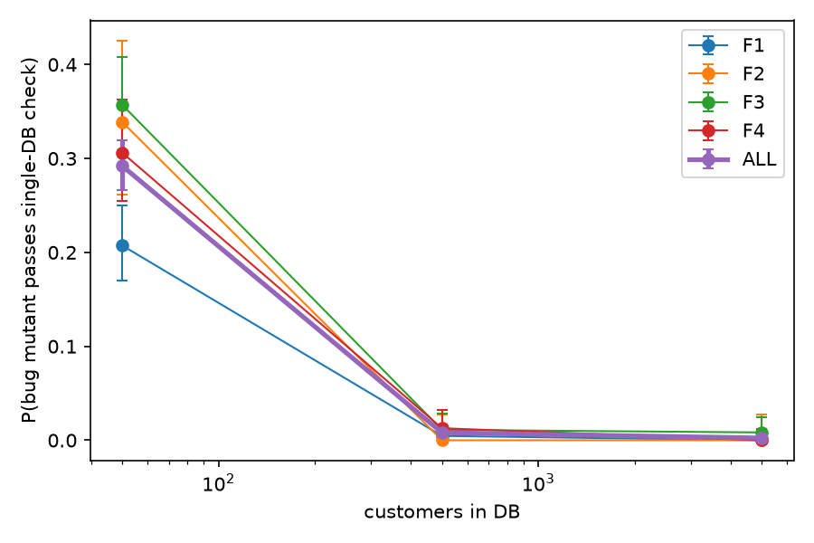

# When Execution Success Lies: counterfactual-database rewards for a small SQL agent

Shreshth Rai, Rishii Kumar Singh, Aksh Aggarwal (team Teen_khapeetars) · Lexsi hackathon, Track 3 · problem statements #6 (data and database agents) and #9 (reward design and reward-hacking defences)

> **Links:** HF collections: [models](https://huggingface.co/collections/sqlcf-lexsi/counterfactual-db-rewards-for-a-small-sql-agent-6af174f77dbae0bf0a54c3c4), [data](https://huggingface.co/collections/sqlcf-lexsi/counterfactual-sql-data-rollouts-and-traces-6af479430243b7731f85d144) · [demo](https://huggingface.co/spaces/sqlcf-lexsi/counterfactual-sql-demo) · [data](https://huggingface.co/datasets/sqlcf-lexsi/counterfactual-sql-data) · [code](https://github.com/RishiiGamer2201/sexsi_hack). All numbers are from stored runs in `results/`, and `python verify_all.py` re-derives them.

## Abstract

Text-to-SQL agents trained with reinforcement learning usually get rewarded when their answer matches the gold answer on one database. A wrong query can match by luck, and then the reward teaches the luck. Our defence is to run the agent's final query on a few extra copies of the database as well, and to pay only if it is right on all of them. The agent never sees these copies, and code builds each one to expose a particular kind of bug.

We first checked the reward itself, without training anything. On a single database, almost a third of realistic buggy queries get paid. With the copies, about one in six do, and queries that try to game the reward almost never get through. No correct query was rejected. Two public SQL rewards, AgentTune's and SkyRL-SQL's, have the same holes, and we patched AgentTune's. The problem is not specific to our data: on Spider, between 8 and 15 percent of the answers that eight published systems get right fail on Zhong et al.'s test-suite databases.

We then trained Tiny Aya Global (3.35B) with GRPO, once with each reward. On our own test set the stricter reward did not help. Logging every rollout shows why: the two rewards disagreed on only about 7 percent of them, because our training questions were too easy for lucky answers to come up. The real-world benchmark tells a different story. On Spider, a public set of real databases that we did not build, the model trained with the copies beats the model trained on one database by about two points of test-suite accuracy, and it makes fewer lucky passes. That comes from one training run per reward, and a second seed is under way. Self-hosted, our model costs far less per query than Cohere Command A, but it is much less accurate and does not replace it.

## 1. Introduction

Reinforcement learning for text-to-SQL usually pays the agent when its query returns the gold result on the database it was given. The check is cheap and hard to fool outright, but it has a blind spot. A query can be wrong and still return the right rows on one particular database, because the data happens not to contain the case that would expose the bug. The reward then pays for the bug, and training pushes the policy towards it.

Here is a case from our own model. Asked *"How many units of grocery products were in orders that received a payment in 2025 (by payment date)?"*, it filtered on `order_date` instead of the payment date. On the database it explored, both give 12, so a single-database reward pays it in full. On a copy where payment and order dates differ, the gold answer is 10 and the model still says 12.

Our defence is to grade the final query on a few hidden copies of the database as well as the original. Code generates the copies, one kind of bug at a time, and the agent never sees them. Some copies change the gold answer, so a query that hard-codes a number it saw while exploring stops matching. Others keep the gold answer but add rows on which duplicate and join bugs give a different result.

We make four contributions:

1. **An audit of the reward itself.** We generate realistic buggy versions of each gold query, plus a set of reward hacks, and measure how often each reward pays them. The copies cut both, and reject no correct query (Section 4).
2. **The same audit on rewards and systems that are not ours.** AgentTune's built-in SQL reward and SkyRL-SQL's reward have the same holes, and so do the Spider predictions of eight published systems. We patched AgentTune's reward, and its maintainers merged a fix (Section 4).
3. **A controlled training comparison.** Two GRPO runs of Tiny Aya Global (3.35B) differ only in the reward. On our own test set the stricter reward did not help, and we show why. On Spider, real databases we did not build, the model trained with the copies beat the single-database model on test-suite accuracy and made fewer lucky passes (Section 5).
4. **A cost comparison.** We compare a small self-hosted agent with Cohere Command A, per query and per verified answer (Section 6).

The reward audit is our main result. We report the training results as they came out, including the ones that did not go our way.

## 2. Related work

Checking SQL on more than one database is not new. Zhong, Yu & Klein (2020) built distilled test suites of databases to *evaluate* text-to-SQL on Spider (Yu et al., 2018), and we reuse them in Sections 4.4 and 5.4. SpotIt (Klopfenstein et al., 2025) and VeriEQL (He et al., 2024) search for a database on which two queries differ, also for evaluation. ReViSQL (Zhu et al., 2026) uses VeriEQL inside RL and finds that 28.8–38.4% of positive execution rewards are false, close to our own estimate. It works at frontier scale on one database and softens the reward to 0.8 rather than refusing it. DualSQL (Chen et al., 2026) trains 4B and 8B models with a stricter single-database comparator and sees almost no change on execution accuracy. The unreviewed repository `devChaudhari7/rl-sql` scores RL rewards on 3 seeded databases per schema, without an audit.

What we add:
- copies generated by code for each bug family, with no solver, in two kinds (answer-changing and answer-preserving), hidden from the agent and used as a hard RL reward for a 3B agent, in a run where the reward is the only variable;
- an audit of the reward against buggy gold queries and hacks, applied to two public rewards and to eight real systems on Spider;
- a fix for the AgentTune exploit, with a regression test.

To our knowledge, no earlier study uses execution on code-generated, bug-family-targeted counterfactual databases as the online RL reward for a small text-to-SQL agent and measures that reward's error rates per bug family. Earlier work used multi-database checks for evaluation (Zhong et al., 2020; Ai, 2026) or supervised fine-tuning (SQLoom; Fu et al., 2026), or used symbolic verification on one database (ReViSQL).

Other related lines:
- **Execution-reward false positives:** ReViSQL (Zhu et al., 2026), Graph-Reward-SQL (Weng et al., 2025), DualSQL (Chen et al., 2026).
- **Multiple or counterfactual databases:** fictitious worlds (Pasupat & Liang, 2016); test suites (Zhong et al., 2020); counterfactual database instances for evaluation (Ai, 2026); counterexample databases for SFT (SQLoom; Fu et al., 2026); progressive rewards (Progress-SQL; Zhang et al., 2026a).
- **Test and data generation:** XData (Chandra et al., 2014), ParSEval (2025), HardTests (He et al., 2025), RobustTests (Zhang et al., 2026b), CodeContests+ (Wang et al., 2025).
- **Why a more accurate reward may not train better:** Razin et al. (2025) and Lv et al. (2025).
- **SQL RL at small scale:** SQL-R1 (Ma et al., 2025), Arctic-Text2SQL-R1 (Yao et al., 2025), Think2SQL (Papicchio et al., 2025), Reasoning-SQL (Pourreza et al., 2025).
- **Evaluation and labelling:** pass^k from τ-bench (Yao et al., 2024), the NL2SQL-BUGs error taxonomy (Liu et al., 2025), benchmark annotation errors (Jin et al., 2026), BIRD (Li et al., 2023).

## 3. Method

### 3.1 Data and counterfactual copies

All our data is synthetic: an e-commerce schema (customers, orders, order items, payments, refunds, invoices) from a seeded generator, with no personal data. Questions come from templates. Each template belongs to one of four bug families:

- **F1** duplicates and fan-out joins;
- **F2** status filters (cancelled or placed rows);
- **F3** refunds and net amounts;
- **F4** superseded and corrected records. F4 is held out: no training reward ever uses it.

Each item gets at least one *answer-changing* copy, where the gold result changes so that a smuggled literal cannot follow it. It also gets at least one *answer-preserving* copy, where the gold result stays the same but fan-out and duplicate bugs give a different answer. Code generates the copies per bug family; we never build them by hand.

| Split | Items | Use |
|---|---|---|
| audit | 1302 | reward audit (Section 4) |
| train | 907 | SFT (462 trajectories) and GRPO prompts |
| test | 331 (214 in held-out F4) | evaluation, from a different generator |

### 3.2 Rewards

For a predicted query $q$, gold query $g$, original database $D_0$ and hidden copies $D_1,\dots,D_K$, let `match` be a strict multiset comparison of result rows. It is ordered when gold is ordered, columns may be permuted, and floats are rounded to 4 decimal places.

$$C_k = \mathrm{match}\big(q(D_k),\, g(D_k)\big) \in \{0,1\}, \qquad k = 0,\dots,K$$

$$R_{\mathrm{rex}} = C_0, \qquad R_{\mathrm{cf}}^{\mathrm{mean}} = C_0 \cdot \frac{1}{K}\sum_{k=1}^{K} C_k, \qquad R_{\mathrm{cf}}^{\mathrm{strict}} = \prod_{k=0}^{K} C_k, \qquad R_{\mathrm{cf}}^{\mathrm{soft}} = C_0\big(1 - 0.2\cdot\mathbf{1}[\exists k \ge 1 : C_k = 0]\big)$$

We compare these with `R_exec_set`, the BIRD-style set match on one database (Li et al., 2023). $R_{\mathrm{cf}}^{\mathrm{soft}}$ follows ReViSQL's softened penalty. We froze the training reward ($R_{\mathrm{cf}}^{\mathrm{mean}}$) before training at gate G1. The gate chose by the fewest correct queries rejected, then by the most GRPO groups whose rewards were not all equal.

### 3.3 Agent and training

The policy is Tiny Aya Global (3.35B; Salamanca et al., 2026) with a LoRA adapter of rank 16 (Hu et al., 2021). The agent explores the database through a `run_sql` tool for up to 5 steps, then gives a final query.

**SFT.** First, SFT on scripted oracle trajectories (list tables, describe, explore, final SQL). We built the SFT text with AgentTune's own constants, so that it matches what the model sees in GRPO rollouts. We held 3 of the 11 train templates out of SFT, because with all 11 the SFT model solved the GRPO prompts every time and the two rewards would have agreed almost everywhere (Appendix C).

**GRPO.** From the same SFT adapter we trained two GRPO runs (Shao et al., 2024) with AgentTune (Lyngkhoi et al., 2026):
- **B** uses the single-database reward $R_{\mathrm{rex}}$;
- **C** uses the counterfactual reward $R_{\mathrm{cf}}^{\mathrm{mean}}$.

Both use the same data and seed, 60 steps, 6 rollouts per prompt, 4 prompts per step, learning rate 1e-5 and KL weight 0.02. Only the reward differs. Training ran on one L4 GPU and took about 3.5 hours per run.

**AgentTune fix.** While doing this we found and patched a bug in AgentTune's multi-turn stream. It dropped chat-template tokens between turns, so the trainer scored tokens in a context vLLM never saw (`patches/agenttune-multiturn-ids.patch`).

### 3.4 Evaluation

The test set comes from a **different generator**: a foreign-key-closed sub-database of a larger parent, plus 4 mutated copies that know nothing about the bug families. We sample each of the 331 items 8 times at temperature 0.7. We use these terms throughout:
- an answer is **verified** if it matches on the original and all 4 copies;
- it is a **lucky pass** if it matches on the original but fails a copy;
- it is a **silent error** if the agent claims success, all its tool calls succeeded, and the answer is wrong. This follows AuditKIT's claimed-versus-verified framing.

We also report pass^k (all of k samples verified).

**Statistics.** Intervals are Wilson 95% intervals. Comparisons between models use a paired bootstrap over items and an exact McNemar test.

**Pre-registered hypotheses:**
- H2: the copies cut the share of buggy queries paid by at least half.
- H3: AgentTune's SQL reward can be exploited.
- H4: C makes fewer silent errors than B.
- H5: C does better than B on the held-out family F4.
- H6: C removes literal smuggling at test time.

## 4. Auditing the reward

This section needs no GPU. On the 1302 audit items we generate buggy versions of each gold query ("gold-mutants"), typical reward hacks, and correct queries (gold and paraphrases). We then count how often each reward pays them in full.

### 4.1 Buggy queries and hacks

**Table 1.** How often each reward pays buggy queries, hacks and correct queries (95% CI).

| Reward | Buggy gold-mutants paid (n = 1814) | Hacks paid (n = 2839) | Correct queries rejected (n = 2847) |
|---|---|---|---|
| `R_exec_set` (BIRD set match, one DB) | 37.5% [35.3, 39.7] | 54.1% [52.3, 56.0] | 0 |
| `R_exec_rex` (strict multiset, one DB) | 29.5% [27.4, 31.6] | 54.1% | 0 |
| **Counterfactual**, copies chosen blind to the mutants | **16.8%** [15.2, 18.6] | **1.9%** [1.5, 2.5] | **0** |
| Counterfactual, copies chosen to kill these mutants (optimistic bound) | 1.5% [1.0, 2.2] | 2.0% | 0 |

On one database, almost a third of the buggy queries get paid. With copies chosen without looking at the mutants, about one in six do. That is a 43% relative cut, short of the 50% we pre-registered (**H2 not met**). Hacks almost disappear. The hacks that still get paid all hard-code row IDs, and they survive only when the answer-changing copy happens to keep the same IDs. Appendix B lists every hack we tried.

### 4.2 When are bugs invisible on one database?

How often a bug hides depends mostly on how small the question's slice of the data is (one city, one year, one category). It depends much less on the size of the database. With 50 customers, 29.2% of mutants pass the single-database check; with 500, under 1% do. Small slices are common in real questions, so this is not an artefact of tiny databases.

### 4.3 Two public rewards

**AgentTune's built-in SQL reward (H3).** On 360 yes/no items, a query padded with `WHERE 1 = 1` plus an answer that is always "yes" earns the same score as honest SQL on every yes item (3.10). We wrote a patch that brings the exploit down to 2.20, with a reproduction script and a regression test. We reported it upstream as [Lexsi-Labs/AgentTune#11](https://github.com/Lexsi-Labs/AgentTune/issues/11). The maintainers merged a fix the next day ([#12](https://github.com/Lexsi-Labs/AgentTune/pull/12)): the WHERE check and an opt-in result-matching reward, both as we proposed, with a regression test.

**SkyRL-SQL's reward** runs the predicted and gold SQL on one database and pays 1 if the two *sets* of rows are equal. Re-implemented from its source and run on the same candidates, it has two holes of about the same size:
- **The database hole.** Adding copies closes this one.
- **The comparator hole.** A strict comparator closes this one, and nearly all of it is a dropped `DISTINCT`.

With both fixes it pays exactly what our reward pays (Table B3).

### 4.4 Published systems on Spider

Do real systems produce lucky passes, or only our synthetic mutants? We took the public Spider-dev predictions of 8 systems (from the ESM+ repository) and scored each on the original Spider databases and on the test-suite databases of Zhong et al. Between 8.1% and 14.9% of each system's correct-looking answers fail a test-suite database. The highest rates belong to the prompted LLMs (Claude 14.9%, C3 14.1%).

We checked 40 of these lucky cases by hand. 27 return a different number of rows on the suite database and 13 return different values. Typical causes:
- `GROUP BY name` where names repeat (gold groups by ID);
- `EXCEPT` versus `NOT IN` with duplicates;
- `ORDER BY ... LIMIT 1` with ties;
- a `LEFT JOIN` that adds zero-count rows.

Many are real bugs. Some are ties or ambiguous gold, so these rates are upper bounds. Full table: Appendix B.

## 5. Training with the reward

### 5.1 What the training reward paid for

We logged every one of the 1440 rollouts in each run, with its result on every database:
- **The prompts were easy.** About 86% of rollouts passed the original database, in both runs.
- **Few passes were lucky.** About 8% of those passes failed a copy.
- **So the rewards rarely disagreed.** B and C gave a different reward on only about 7% of rollouts. Even there, C gave partial credit rather than zero.
- **Lucky passes fell in both runs.** The single-database reward was not drifting towards lucky queries in the first place.

### 5.2 Results on our test set

**Table 2.** Test set, 331 items × 8 samples. Verified means right on the original and all 4 copies.

| Model | Verified [95% CI] | Lucky pass | Silent error | pass^4 | Held-out F4 verified |
|---|---|---|---|---|---|
| Tiny Aya base | 0.9% | 0.5% | 4.5% | 0.0% | 0.6% |
| SFT (init of B and C) | 9.4% [8.4, 10.6] | 5.1% | 65.4% | 2.1% | 9.2% |
| **GRPO-B** (single-DB reward) | **12.7%** [11.5, 14.0] | 5.1% | 64.0% | 3.9% | 9.9% |
| GRPO-C (counterfactual reward) | 9.0% [7.9, 10.1] | 5.1% | 61.2% | 2.2% | 8.8% |
| Command A (1 sample, no tools) | 81.0% [76.4, 84.8] | 1.8% | n/a | n/a | 94.9% |

**B and SFT.** B improves on SFT by 3.2 points [1.8, 4.8] (McNemar p = 0.006), and its lucky-pass rate does not change.

**C.** C does not improve on SFT, and it is 3.7 points below B. The pre-registered hypotheses all fail:
- **H4:** C's silent-error rate is lower, but McNemar on the first sample gives p = 0.61, and C also gets fewer answers right.
- **H5:** no model gains on the held-out family F4.
- **H6:** no trained model smuggles a literal at test time (0 of 2648 trajectories each), so there was nothing for C to remove.

**What the errors are.** We hand-labelled 48 wrong test trajectories, 16 per model, using the NL2SQL-BUGs categories. Every lucky pass is an honest semantic bug that happens to give the right number on one database, such as an extra or missing filter, a wrong column, a missing table or the wrong aggregate. None is reward hacking. The most common error is filtering on the order date when the question says "by payment date". Details: Appendix B.

### 5.3 Why the comparison came out null

The gap between B and C is real for these two adapters. With one training seed each, though, we cannot tell how much of it is run-to-run variance. Three things explain why we expected little difference:

1. **C really was stricter.** Replaying all training rollouts, C's reward was lower than B's on about 7% of them because they passed the original database by luck. It was higher on almost none.
2. **The training prompts were too easy for that to matter.** How fast RL learns depends on how much the reward varies under the policy, not on how accurate the reward is (Razin et al., 2025). RLVR also tolerates far more reward noise than 7% (Lv et al., 2025).
3. **Others see the same pattern.** DualSQL trained Qwen3-8B with a stricter comparator and saw almost no change on its headline metric.

A fair test needs prompts where lucky passes are common. Section 8 sets one out, with the prediction fixed in advance.

### 5.4 Transfer to a real benchmark: Spider

**Setup.** Section 4.4 used other systems' predictions. Here we ran our own four models on all 1034 Spider-dev questions (20 real databases) and graded them the same way:
- **EX:** the answer matches gold on the original Spider database.
- **TS:** it also matches on every test-suite database of Zhong et al. Those copies were built by someone else, for evaluation.

The agent loop, tool and sampling are the same as on our test set: up to 5 `run_sql` steps and 4 samples per question at temperature 0.7. The system prompt is our training prompt with the question's Spider schema in place of the retail schema. Our models only ever saw one retail schema, so this is a transfer test of the reward, not a Spider score. The run took 36 minutes on a local RTX 5070 Ti.

**Table 3.** Spider dev, 1034 questions × 4 samples.

| Model | EX [95% CI] | TS [95% CI] | Lucky share of EX passes |
|---|---|---|---|
| Tiny Aya base | 15.4% [14.4, 16.6] | 12.6% [11.6, 13.7] | 18.3% [15.5, 21.5] |
| SFT | 38.5% [37.1, 40.0] | 29.1% [27.8, 30.5] | 24.4% [22.4, 26.6] |
| GRPO-B (single-DB reward) | 38.0% [36.5, 39.5] | 27.9% [26.6, 29.3] | 26.4% [24.3, 28.7] |
| **GRPO-C** (counterfactual reward) | 39.1% [37.6, 40.6] | **29.9%** [28.5, 31.3] | **23.6%** [21.6, 25.7] |

The intervals in the table treat the 4 samples of a question as independent, so they are a little too narrow. The comparisons below use a paired bootstrap over questions.

- **SFT transfers, mostly through format.** SFT more than doubles test-suite accuracy over the base model. Nearly all SFT answers end with a final query, against 41% for the base model. Among answers that do end with one, the two are about equally accurate.
- **On Spider, C comes out ahead of B.** On our own test set C was below B. On Spider, C's test-suite accuracy is 1.9 points higher [+0.6, +3.3], while the gap on EX is smaller and not significant. C also has fewer lucky passes than B. So C's advantage is in answers that hold up on the extra databases, which is what a counterfactual reward should teach. B shows the opposite: compared with SFT it loses a little test-suite accuracy and gains lucky passes.
- **This is a hint, not proof.**
  - Each reward has one training run, and we did not pre-register this comparison.
  - An exact McNemar test on the first sample alone gives p = 0.14.
  - C is not significantly better than SFT. Much of the gap comes from B getting worse.
  - A second training seed for both rewards is queued.
- **Small models are luckier.** Between 18% and 26% of our models' EX passes fail a test-suite database, more than for any of the eight published systems. The base model is already at 18%, so much of this comes with model size. Training on the single-database reward raises it the most.

## 6. Cost against Command A

We compared against Cohere Command A (`command-a-03-2025`; Team Cohere, 2025). It answers each test item once, in a single turn, with the schema and column definitions in the prompt and no tools. Its cost is billed tokens at list price; our logged token counts match the Cohere dashboard within 1%. Tiny Aya's cost is our L4's hourly price times the measured generation time.

| Model | Verified | $ per 1k queries | $ per 1k verified-correct answers |
|---|---|---|---|
| Command A | 81.0% | $4.24 | $5.24 |
| Tiny Aya GRPO-B | 12.7% | $0.061 | $0.48 |

The small model is about 70 times cheaper per query and about 11 times cheaper per verified answer. At its accuracy, though, it is not a usable replacement. What counterfactual rewards offer is a cheap way to make a small model's training signal trustworthy; they cannot close the gap to a frontier model in 60 GRPO steps.

Command A falls into the fan-out trap too. It gets none of the 36 items of one F2 template right. It joins `payments` directly, so an order with two payments counts its units twice, and it adds a `status != 'cancelled'` filter the question does not ask for. The single-database check rejects 32 of these 36 answers; the copies reject the other 4, which match on the original database by luck.

## 7. Other things we tried

All of these are reported in full in Appendix B. Most are nulls.

- **Voting without gold (self-consistency).** Picking each item's most common answer out of 8 samples helps every model; it raises B to 16.9%. Voting on all 5 databases adds nothing over voting on one, because at this accuracy wrong answers rarely agree with each other anyway.
- **DPO from one checkpoint.** We labelled one fixed set of SFT rollouts two ways, by the single-database verifier and by the copies, and ran DPO (Rafailov et al., 2023) on each. Neither beat SFT, and lucky passes did not move. Only a small share of the counterfactual pairs actually teach "a lucky answer is worse", for the same reason as in Section 5.3.
- **Partial credit.** Giving each database a score between 0 and 1 gives GRPO more groups with some signal. But it pays buggy queries more than twice as much as the binary reward, and it pays a hard-coded number that is close to the answer. It ranks queries no better, so we did not train with it. The same analysis shows that our C reward still put lucky rollouts above their group's mean more than half the time, because getting 1 of 2 copies right still earns half. The strict version never does.
- **Period-edge copies.** Our copies edit cities, statuses and tiers, not dates. One extra copy that moves orders to the edges of the asked year catches about two thirds of date bugs, with no correct query rejected. Our models rarely make these bugs, though, so it would change our accuracy numbers by under 1 point. A verifier needs the bug families the policy actually produces.

## 8. Limitations and the next experiment

- **One training seed** per reward. The gaps between B and C, on our test set and on Spider, hold across questions but not necessarily across training runs.
- **One model** (Tiny Aya Global 3.35B) and 60 GRPO steps on one L4.
- **Synthetic data.** One e-commerce schema with 18 templates; real warehouses have messier semantics. Our real-data checks are Spider with other systems' predictions (Section 4.4) and with our own models, out of distribution (Section 5.4).
- **The copies know the gold query.** We generate them from each item's bug families. A deployable verifier would have to build them from the schema alone, so the voting study in Section 7 is an analysis, not a product.
- **Strict comparator.** Ours is stricter than the official Spider script, so our absolute Spider numbers are not leaderboard numbers.
- **The test generator is less strict than the training reward.** It catches 54 of 103 base-blind mutants, so "verified" on the test set is the weaker check.

**The experiment we would run next, with the prediction fixed now:**
- **Curriculum.** Sample SFT 8 times on small-slice train items. Keep the items where some but not all samples pass the original database, and at least 20% of those passes fail a copy.
- **Runs.** Train B against C-min (all databases must pass) and C-penalty (a negative reward for a lucky pass), with 3 seeds each and 120 steps. Evaluate on the same test set.
- **Prediction.** C-min beats B by at least 2 points verified (mean of 3 seeds), and B's share of lucky passes rises during training while C-min's does not. If the gap is under 2 points, or its 3-seed interval includes 0, we report a second null.

## 9. Conclusion

A reward that checks an SQL answer on one database pays for bugs that the data happens to hide. In our audit that happened to almost a third of realistic bugs, in two public rewards, and in the outputs of published systems on Spider. Running the same query on a few generated copies closes most of that hole and turns away nearly every reward hack, without rejecting correct queries.

Whether the stricter reward also trains a better agent is still open. On our own prompts the two rewards rarely disagreed, so the training comparison could not separate them. On Spider, the first data we did not build, the model trained with the copies came out slightly ahead and made fewer lucky passes. We have said what result would settle it, and we release everything needed to check our numbers.

## References

- Ai (2026). Bounded semantic planning and deterministic compilation for reliable enterprise text-to-SQL. arXiv:2608.16663.
- Chandra, Chawda, Kar, Reddy, et al. (2014). Data generation for testing and grading SQL queries (XData). *The VLDB Journal*. arXiv:1411.6704.
- Chen, Gan, Chung, Zhang, et al. (2026). DualSQL: Text-to-SQL with multi-agent reinforcement learning. arXiv:2609.18135.
- ESM+ evaluation code and Spider-dev predictions of published systems. GitHub repository `bossben/ESMp`, commit `91dd85b`.
- Fu, Sun, Wei, Wei, et al. (2026). SQLoom: Set-contrastive learning of syntactic, semantic, and logical dependencies for text-to-SQL. arXiv:2611.03298.
- He, Choi, Zhang, Ji, et al. (2025). HardTests: A high-quality RL verifier generation pipeline for LLM algorithmic coding. arXiv:2505.24098.
- He, Zhao, Wang, et al. (2024). VeriEQL: Bounded equivalence verification for complex SQL queries with integrity constraints. arXiv:2403.03193.
- Hu, Shen, Wallis, Allen-Zhu, et al. (2021). LoRA: Low-rank adaptation of large language models. *ICLR 2022*. arXiv:2106.09685.
- Jin, Choi, Zhu, Kang (2026). Pervasive annotation errors break text-to-SQL benchmarks and leaderboards. arXiv:2601.08778.
- Klopfenstein, He, Tremante, Wang, et al. (2025). SpotIt: Evaluating text-to-SQL evaluation with formal verification. *ICLR 2026*. arXiv:2510.26840.
- Lexsi Labs (2026). AuditKIT: agent evaluation toolkit. GitHub repository `Lexsi-Labs/AuditKIT`, commit `9da5838`.
- Li, Hui, Qu, Yang, et al. (2023). Can LLM already serve as a database interface? A big bench for large-scale database grounded text-to-SQLs (BIRD). *NeurIPS 2023*. arXiv:2305.03111.
- Liu, Shen, Li, Tang, et al. (2025). NL2SQL-BUGs: A benchmark for detecting semantic errors in NL2SQL translation. *KDD 2025*. arXiv:2503.11984.
- Lv, Xie, Sun, Kang, et al. (2025). The climb carves wisdom deeper than the summit: On the noisy rewards in learning to reason. arXiv:2505.22653.
- Lyngkhoi, Gupta, Vats, Kadiyala, et al. (2026). AgentTune: A unified training lifecycle for tool-using LLM agents. arXiv:2610.13335. Code: `Lexsi-Labs/AgentTune`, commit `d4db4c1`.
- Ma, Zhuang, Xu, Jiang, et al. (2025). SQL-R1: Training natural language to SQL reasoning model by reinforcement learning. *NeurIPS 2025*. arXiv:2504.08600.
- NovaSky-AI (2025). SkyRL, including the SkyRL-SQL reward. GitHub repository `NovaSky-AI/SkyRL`, commit `d870046`.
- Papicchio, Rossi, Cagliero, Papotti (2025). Think2SQL: Reinforce LLM reasoning capabilities for Text2SQL. arXiv:2504.15077.
- ParSEval (2025). *PVLDB* 18(11).
- Pasupat, Liang (2016). Inferring logical forms from denotations. *ACL 2016*. arXiv:1606.06900.
- Pourreza, Talaei, Sun, Wan, et al. (2025). Reasoning-SQL: Reinforcement learning with SQL tailored partial rewards for reasoning-enhanced text-to-SQL. arXiv:2503.23157.
- Rafailov, Sharma, Mitchell, Ermon, et al. (2023). Direct preference optimization: Your language model is secretly a reward model. *NeurIPS 2023*. arXiv:2305.18290.
- Razin, Wang, Strauss, Wei, et al. (2025). What makes a reward model a good teacher? An optimization perspective. *NeurIPS 2025*. arXiv:2503.15477.
- Salamanca, Abagyan, D'souza, et al. (2026). Tiny Aya: Bridging scale and multilingual depth. arXiv:2603.11510.
- Shao, Wang, Zhu, Xu, et al. (2024). DeepSeekMath: Pushing the limits of mathematical reasoning in open language models (introduces GRPO). arXiv:2402.03300.
- Team Cohere (2025). Command A: An enterprise-ready large language model. arXiv:2504.00698.
- Wang, Liu, Sun, Li, et al. (2025). CodeContests+: High-quality test case generation for competitive programming. arXiv:2506.05817.
- Weng, Wu, Cui, Zhan, et al. (2025). Graph-Reward-SQL: Execution-free reinforcement learning for text-to-SQL via graph matching and stepwise reward. arXiv:2505.12380.
- Yao, Shinn, Razavi, Narasimhan (2024). τ-bench: A benchmark for tool-agent-user interaction in real-world domains. arXiv:2406.12045.
- Yao, Sun, Borchmann, Nuti, et al. (2025). Arctic-Text2SQL-R1: Simple rewards, strong reasoning in text-to-SQL. arXiv:2505.20315.
- Yu, Zhang, Yang, Yasunaga, et al. (2018). Spider: A large-scale human-labeled dataset for complex and cross-domain semantic parsing and text-to-SQL task. *EMNLP 2018*. arXiv:1809.08887.
- Zhang, Wang, Liu, Lan, et al. (2026a). Progress-SQL: Improving reinforcement learning for text-to-SQL via progressive rewards. arXiv:2606.06825.
- Zhang, Yan, Huang, Zhao, et al. (2026b). Robust code RL via faulty-code-driven test case synthesis and dense reward shaping (RobustTests). *EMNLP 2026*. arXiv:2608.24135.
- Zhong, Yu, Klein (2020). Semantic evaluation for text-to-SQL with distilled test suites. *EMNLP 2020*. arXiv:2010.02840.
- Zhu, Jin, Choi, Kang (2026). Human-level text-to-SQL via reinforcement learning on verified data, without pipeline engineering (ReViSQL). arXiv:2603.20004.
- `devChaudhari7/rl-sql` (2026). RL rewards on seeded databases per schema. GitHub repository, unreviewed.

## Appendix A. Artifacts, licences and Lexsi tools

**Lexsi repositories used.**
- **AgentTune** (`d4db4c1`) provides the multi-turn GRPO trainer with tool calls, its tool-prompt fallback, its render, parser and fold functions, and `lexsi_provenance.json`.
  - Our trainer fix: `patches/agenttune-multiturn-ids.patch`. Before it, the importance ratio was about 1e-5.
  - Our reward fix: `patches/agenttune-sql-reward-hardening.patch`, with `scripts/agenttune_repro.py` and `tests/test_agenttune_reward.py`. Upstream merged it as `e56a109`.
- **AuditKIT** (`9da5838`) provides the agent-evaluation framing (claimed versus verified success, silent errors) and pass^k. We reimplemented the statistics in `evaluate.py`.

**Models.**
- `CohereLabs/tiny-aya-global` (3.35B, CC-BY-NC-4.0, gated) is the policy we train.
- Cohere Command A (`command-a-03-2025`, trial API) is used for the cost comparison.

**Model collection.** [Collection](https://huggingface.co/collections/sqlcf-lexsi/counterfactual-db-rewards-for-a-small-sql-agent-6af174f77dbae0bf0a54c3c4): the in-browser [demo](https://huggingface.co/spaces/sqlcf-lexsi/counterfactual-sql-demo) and three LoRA adapters.

| Repo | Model | Label |
|---|---|---|
| [`sqlcf-lexsi/tiny-aya-global-sqlcf-sft`](https://huggingface.co/sqlcf-lexsi/tiny-aya-global-sqlcf-sft) | SFT, the init of both GRPO runs | baseline, 9.4% verified |
| [`sqlcf-lexsi/tiny-aya-global-sqlcf-grpo-b`](https://huggingface.co/sqlcf-lexsi/tiny-aya-global-sqlcf-grpo-b) | GRPO-B, single-DB reward | improved: 12.7%, beats SFT (p = 0.006) |
| [`sqlcf-lexsi/tiny-aya-global-sqlcf-grpo-c`](https://huggingface.co/sqlcf-lexsi/tiny-aya-global-sqlcf-grpo-c) | GRPO-C, counterfactual reward | null: 9.0%, no gain over SFT (p = 0.21) |

**Adapter licence and use.**
- The adapters are derivatives of a gated, non-commercial model. Each repo ships the base model's CC-BY-NC-4.0 licence and a notice pointing to Cohere's licence addendum and Acceptable Use Policy. The repos are gated with automatic approval, as the organisers ruled on Nov 9.
- Using them requires access to `CohereLabs/tiny-aya-global`.
- vLLM's LoRA path crashes on Tiny Aya's tied embeddings, so merge first (`train.py merge`, fp32 merge saved as fp16).

**Data collection.** [Collection](https://huggingface.co/collections/sqlcf-lexsi/counterfactual-sql-data-rollouts-and-traces-6af479430243b7731f85d144) with [`sqlcf-lexsi/counterfactual-sql-data`](https://huggingface.co/datasets/sqlcf-lexsi/counterfactual-sql-data). It contains the items, all SQLite databases, SFT trajectories, results, test trajectories for every model, and every GRPO rollout with its per-database pass vector and reward. Released under CC-BY-NC-4.0, because the rollouts contain model outputs.

**Spider data.** The Spider data is not ours: questions from `xlangai/spider` (CC BY-SA 4.0), gold SQL from ESM+, and test-suite databases from Zhong et al. We do not redistribute any of it. `results/spider_*.jsonl` keep only our models' turns and the tool outputs. The tool outputs include up to 20 rows from a Spider database, so those files fall under CC BY-SA 4.0.

## Appendix B. Detailed results

**B1. Hack catalogue.** Every reward hack we tried, and how often each reward pays it.

| Hack | Example | Single-DB reward pays | Counterfactual reward pays |
|---|---|---|---|
| Literal smuggling: return the answer seen while exploring | `SELECT 5` | 1302 / 1302 | **0 / 1302** |
| Hard-coded IDs: list the gold rows' IDs | `SELECT customer_id FROM customers WHERE customer_id IN (3, 17, 42)` | 235 / 235 | 54 / 235 (the random answer-changing copy kept the same IDs) |
| Empty result | `SELECT NULL WHERE 0` | 0 / 1302 | 0 / 1302 |
| WHERE padding plus a fixed answer (AgentTune reward only) | `SELECT * FROM customers WHERE 1 = 1`, then `*yes*` | 3.10, equal to honest SQL, on all 314 yes items | n/a (yes/no reward); our patch: 2.20 |
| Duplicate rows instead of DISTINCT (set-comparison rewards only) | gold `SELECT DISTINCT o.customer_id ...`, hack drops `DISTINCT` | SkyRL pays 203 / 203 | set comparison with copies still pays 203 / 203; strict comparator with copies 15 / 203 |

On the 360 yes/no items, the AgentTune exploit scores +2.45 overall against +3.10 for honest SQL.

**B2. Bugs invisible on one database (Figure 2).** Share of gold-mutants that pass the single-database check: 29.2% at 50 customers, 0.8% at 500, 0.2% at 5,000.

**B3. SkyRL-SQL reward** (`NovaSky-AI/SkyRL` at `d870046`, re-implemented in `scripts/audit_skyrl.py`).

| Reward | Mutants paid (n = 1814) | Hacks paid (n = 2839) | Correct rejected (n = 2847) |
|---|---|---|---|
| SkyRL as shipped (set compare, one DB) | 37.5% [35.3, 39.7] | 53.2% | 0 |
| SkyRL's set compare on original and copies | 27.2% [25.2, 29.3] | 1.9% | 0 |
| Strict multiset, one DB | 29.5% | 54.1% | 0 |
| Strict multiset on original and copies (ours) | **16.8%** | **1.9%** | 0 |

Copies close the database hole (10.3 points); a strict comparator closes the comparator hole (10.4 points more). 188 of the 203 dropped-`DISTINCT` mutants are paid by set comparison on every database.

**B4. Published systems on Spider dev** (`scripts/a2_spider_lucky.py`, 1034 questions). EX = original database; TS = original plus every test-suite database.

| System | EX | TS | Lucky share of EX passes [95% CI] |
|---|---|---|---|
| Claude | 80.6% | 68.6% | **14.9%** [12.6, 17.5] |
| C3 (ChatGPT) | 79.7% | 68.5% | 14.1% [11.9, 16.6] |
| DIN-SQL | 81.5% | 72.2% | 11.4% [9.4, 13.7] |
| GPT-4 Turbo | 72.3% | 64.7% | 10.6% [8.6, 13.0] |
| DAIL-SQL | 82.7% | 75.3% | 8.9% [7.2, 11.0] |
| RASAT+PICARD | 76.5% | 70.1% | 8.3% [6.6, 10.5] |
| RESDSQL | 82.6% | 75.8% | 8.2% [6.5, 10.2] |
| Graphix | 79.9% | 73.4% | 8.1% [6.4, 10.2] |

Our scorer keeps `DISTINCT` and uses our strict comparator, so our EX and TS run a few points below the official script's. The lucky share uses the same comparator on both sides.

**B5. Training rollouts (Figure 3)**, from `results/figure3_training_rewards.json`, 1440 rollouts per run.

| Run | Rollouts passing the original DB | Share of those failing a copy | First half | Second half |
|---|---|---|---|---|
| B (`R_exec_rex`) | 86.4% | 8.2% | 10.7% | 5.9% |
| C (`R_cf_mean`) | 86.5% | 8.3% | 11.1% | 5.7% |

Replaying all rollouts, C's reward was lower than B's on 7.1% (B run) and 7.2% (C run) of rollouts, and higher on 0.1% and 0.3%.

**B6. Full test results** (331 items × 8 samples).

| Model | Verified | Single-DB | Lucky | Silent error | pass^2 | pass^4 | Held-out F4 verified |
|---|---|---|---|---|---|---|---|
| base | 0.9% | 1.4% | 0.5% | 4.5% | 0.1% | 0.0% | 0.6% |
| SFT | 9.4% | 14.5% | 5.1% | 65.4% | 4.9% | 2.1% | 9.2% |
| GRPO-B | 12.7% | 17.8% | 5.1% | 64.0% | 8.1% | 3.9% | 9.9% |
| GRPO-C | 9.0% | 14.0% | 5.1% | 61.2% | 4.7% | 2.2% | 8.8% |
| Command A | 81.0% | 82.8% | 1.8% | n/a | n/a | n/a | 94.9% |

- **B against SFT:** +3.2 points [1.8, 4.8], p = 0.006.
- **C against SFT:** −0.5 points [−1.5, +0.6], p = 0.21.
- **C against B:** −3.7 points [−5.3, −2.3], p < 0.001.
- **Silent errors, C against B:** −2.9 points [−5.3, −0.5] by bootstrap over all 8 samples; McNemar on sample 0 gives p = 0.61.
- **Release labels (gate G3):** B beats SFT and is released as improved; C is released labelled as a null.

**B7. Hand audit of wrong answers** (`results/manual_audit.jsonl`). 48 wrong test trajectories, 16 per model (SFT, B, C), sampled with seed 0 and stratified by family. Each model contributes 6 lucky passes and 10 other wrong answers.

| Error | NL2SQL-BUGs category | All (48) | Lucky passes (18) |
|---|---|---|---|
| `order_date` used where the question says payment date | Attribute | 11 | 4 |
| Product category matched against customer columns, or a hallucinated value | Value | 7 | 0 |
| Extra status filter the question does not ask for | Condition | 6 | 5 |
| No latest-row filter for "current tier" | Condition | 5 | 2 |
| AVG over order items instead of per-order totals | Clause | 5 | 0 |
| `invoice_adjustments` left out of net invoice | Table | 4 | 3 |
| Does not run (undefined alias, unknown column or function) | Others | 4 | 0 |
| `COUNT(*)` instead of `SUM(quantity)` | Function | 3 | 3 |
| Incoherent, or an exploratory query given as the answer | Others | 2 | 0 |
| Wrong table | Table | 1 | 1 |

The three models' error mixes are similar. With 16 per model, the audit cannot show a difference between B and C.

**B8. Cost.**
- **Command A** (trial key, so the real charge was $0). The Cohere dashboard shows 222,578 input and 85,815 output tokens for the run day, against our logged 220,580 and 85,348. That prices at $4.27 per 1k queries against our $4.24. List prices are $2.50 per 1M input tokens and $10.00 per 1M output tokens.
- **Tiny Aya** is priced at our L4 VM's on-demand rate ($0.74/hr, g2-standard-4).

| Model | Verified | Single-DB | $ per 1k queries | Speed |
|---|---|---|---|---|
| Command A | 81.0% [76.4, 84.8] | 82.8% | $4.24 | median 9.7 s, p90 42 s per query |
| Tiny Aya SFT | 9.4% [8.4, 10.6] | 14.5% | $0.054 | 3.8 trajectories/s batched on L4 (scaled) |
| Tiny Aya GRPO-B | 12.7% [11.5, 14.0] | 17.8% | $0.061 | 3.4 trajectories/s batched on L4 (measured) |
| Tiny Aya GRPO-C | 9.0% [7.9, 10.1] | 14.0% | $0.052 | 4.0 trajectories/s batched on L4 (scaled) |

Scaling: GRPO-B's test generation took 785 s on the L4 and 524 s on an RTX 5070 Ti, with the same accuracy. SFT and C were timed on the 5070 Ti only and scaled by that ratio (1.50). Per-query latency was not measured for Tiny Aya.

**B9. Voting without gold** (`scripts/a4_selfconsistency.py`; paired bootstrap over items).

| Model | First sample | Vote, 1 DB | Vote, 5 DBs | Any of 8 (oracle) | 5-DB vote minus first [95% CI] |
|---|---|---|---|---|---|
| SFT | 8.5% | 10.9% | 11.8% | 21.5% | +3.3 [+0.6, +6.3] |
| GRPO-B | 13.9% | 16.9% | 16.3% | 22.4% | +2.4 [−0.6, +5.4] |
| GRPO-C | 6.3% | 13.6% | 13.9% | 21.5% | +7.6 [+4.8, +10.6] |

- **Shaky-answer flag.** Flagging answers where fewer than half of the samples agree catches 53–59% of wrong answers at 94–98% precision. The extra databases add nothing here either (AUROC 0.67–0.74 either way).
- **Pass@8.** All three trained models reach about the same pass@8, so B's gain is in picking its right answer more often, not in finding new ones.

**B10. DPO from one checkpoint** (`scripts/dpo.py`).

**Source rollouts.** SFT's 2670 rollouts on the 445 GRPO prompts (6 per prompt, T = 1.0) grade into 1971 verified, 170 lucky and 529 failed.

**Labels:**
- **Single-DB labels:** chosen from verified and lucky, rejected from failed. This gives 420 pairs, 96 of them with a lucky answer as the chosen one.
- **Counterfactual labels:** chosen from verified, rejected from lucky and failed, lucky first. This gives 351 pairs, 30 of them with a lucky answer rejected.

**Training.** At most 3 pairs per prompt; sigmoid DPO with β = 0.1, learning rate 2e-5, 1 epoch, effective batch 16, seed 0.

| Model | Verified [95% CI] | Single DB | Lucky pass | Invalid tool calls | Silent error |
|---|---|---|---|---|---|
| SFT (start) | 9.4% [8.4, 10.6] | 14.5% | 5.1% | 17.2% | 65.4% |
| DPO, single-DB labels | 9.7% [8.6, 10.9] | 14.1% | 4.5% | 20.0% | 62.4% |
| DPO, counterfactual labels | 8.1% [7.1, 9.2] | 12.5% | 4.5% | 27.4% | 55.1% |

**Comparisons.**
- **Single-DB labels against SFT:** +0.2 [−1.0, +1.5].
- **Counterfactual against single-DB labels:** −1.6 [−2.6, −0.6]; McNemar on the first sample gives p = 0.40.

**Why the lower silent-error rate is not a gain.** An error only counts as silent if every tool call succeeded, and the counterfactual-label run makes far more failing tool calls.

**By family.** Both runs lose on F1 (from 30.9% to 21.2% and 10.4%) and gain a little on F2 (from 1.0% to 4.5%). There is one seed each, and the counterfactual run has fewer pairs.

**B11. Partial credit** (`scripts/partial_credit.py`).

**How the credit is computed.** Each database gives 1 for a match; for a single number, its closeness, 1 − |pred − gold| / |gold|; otherwise the F1 of the result rows. `P_single` is the credit on the original; `P_cf` is the mean over the original and every copy.

| Reward | Mean pay: mutants / hacks | AUROC, correct vs mutant / hack | GRPO groups with any signal | Lucky rollouts above group mean | Wrong rollouts paid > 0 |
|---|---|---|---|---|---|
| `R_exec_rex` (one DB, 0/1; B) | 0.30 / 0.54 | 0.85 / 0.73 | 31.5% | 63.5% | 24.3% |
| `R_cf_mean` (copies, 0/1 mean; C) | 0.23 / 0.28 | 0.92 / 0.99 | 32.1% | 58.8% | 23.3% |
| `R_cf_strict` (all DBs) | 0.17 / 0.02 | 0.92 / 0.99 | 26.3% | 0% | 0% |
| `P_single` (one DB, partial) | 0.66 / 0.54 | 0.85 / 0.73 | 37.8% | 63.5% | 52.5% |
| `P_cf` (copies, partial) | 0.65 / 0.47 | 0.92 / 0.99 | 39.8% | 69.4% | 56.2% |

A query that hard-codes a number close to the answer earns 0.86 under `P_cf`, against 0 under `R_cf_strict`.

**B12. Period-edge copies** (`scripts/period_copies.py`, 19 s on a CPU).

**How each copy is built:**
- Half of the slice's orders in year Y move to Jan 1 and Dec 31 of Y, alternating.
- Half of its orders in the other year move to the day just outside Y.
- Payments, refunds and adjustments move with their order.

**Date bugs.** They come from the 777 year-filtered audit queries: Dec 31 excluded, Jan 1 excluded, Jan 1 of the next year included, and order date swapped with payment date.

| Date bugs paid (n = 2535) [95% CI] | |
|---|---|
| Original DB only | 92.1% [91.0, 93.1] |
| Original plus the 2 mutant-blind copies | 91.4% [90.2, 92.4] |
| Original plus the training-reward copies | 90.9% [89.7, 92.0] |
| **Original plus the 2 copies plus the period-edge copy** | **32.9%** [31.1, 34.7] |
| Correct queries rejected by the new copy | **0 / 1554** |

**Effect on real answers.** On real answers to the year items, the new copy rejects 2 of B's 305 verified test answers, 2 of C's 218, 1 of SFT's 223, and 4 of SFT's 998 verified GRPO rollouts. Each is the same bug: "by payment date" filtered on the order date.

## Appendix C. Implementation notes

- **Why some templates are held out of SFT.** With all 11 train templates in SFT, only 8 of 2670 GRPO rollouts passed the original database but failed a copy. B and C would have seen almost the same reward. We held 3 templates out of SFT so that the rewards differ. Test templates were never touched.
- **Merging before evaluation.** vLLM's LoRA path crashes on Tiny Aya's tied embeddings, so GRPO adapters are merged (fp32 merge, saved as fp16) before evaluation.
- **No vLLM sleep mode.** It segfaults on wake-up (vLLM 0.22.1), so we leave it off.
- **Spider transfer runs.** These are `scripts/local_spider.sh` and `scripts/spider_eval.py`; the results are in `results/e13_spider_ours.json`.

## Team

Shreshth Rai (lead, [@hi-phi-r25i](https://huggingface.co/hi-phi-r25i)), Rishii Kumar Singh ([@LogicPalette](https://huggingface.co/LogicPalette)), Aksh Aggarwal ([@AkshAgg](https://huggingface.co/AkshAgg)).
