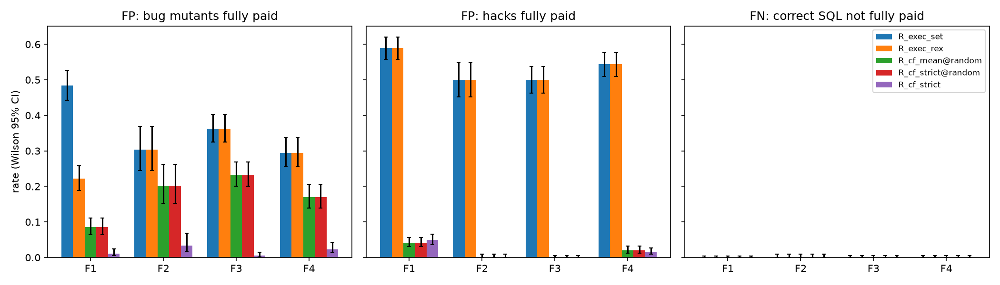
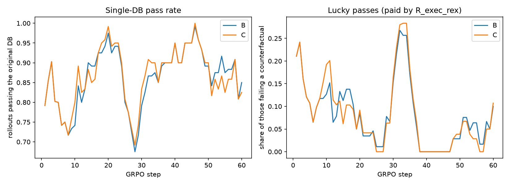

# When Execution Success Lies: counterfactual-database rewards for a small SQL agent

Lexsi hackathon · Track 3 · Problem statements #6 (data and database agents) and #9 (reward design and reward-hacking defences) · team Teen_khapeetars

> **Links:** HF collections: [models](https://huggingface.co/collections/sqlcf-lexsi/counterfactual-db-rewards-for-a-small-sql-agent-6af174f77dbae0bf0a54c3c4), [data](https://huggingface.co/collections/sqlcf-lexsi/counterfactual-sql-data-rollouts-and-traces-6af479430243b7731f85d144) · [demo](https://huggingface.co/spaces/sqlcf-lexsi/counterfactual-sql-demo) · [data](https://huggingface.co/datasets/sqlcf-lexsi/counterfactual-sql-data) · [code](https://github.com/RishiiGamer2201/sexsi_hack). All numbers are from stored runs in `results/`, and `python verify_all.py` re-derives them. The reward audit is the headline; the training comparison came out null and is reported as one.

## 1. The judge's 60-second view

**TL;DR.** Execution rewards for text-to-SQL check the answer on **one** database, so a wrong query that happens to give the right number gets paid. We built a reward auditor that checks answers on code-generated *counterfactual* copies of the database as well. On our audit it cuts the share of hacking queries that get paid from **54.1% to 1.9%**, and of buggy gold-mutants from **29.5% to 16.8%**, while rejecting **0 of 2847** correct queries. The same holes are open in two public rewards (AgentTune's built-in SQL reward and SkyRL-SQL's) and on a real benchmark: **8–15% of the Spider-dev answers that eight published systems "get right" fail on Zhong et al.'s test-suite databases**. We also patched AgentTune's reward. Training a 3.35B agent on the counterfactual reward did **not** beat the single-DB reward (H4 and H5 not supported). We explain why: on our training prompts the two rewards disagreed on only 7% of rollouts. On real data that we did not build, the order flips. On Spider dev, scored on Zhong's test-suite DBs, the counterfactual-reward model is **1.9 pts above** the single-DB one [0.6, 3.3] and pays fewer lucky passes (E13; one seed each, so suggestive only). Section 10 pre-registers the run that would test it properly.

**The reward audit (the contribution).**

| Result | Number (95% CI) | Source |
|---|---|---|
| Reward-hacking queries (literal smuggling, hard-coded IDs, empty) paid | single-DB 54.1% → counterfactual **1.9%** [1.5, 2.5] | `results/e0_reward_audit.json` |
| Buggy gold-mutants paid (strict multiset, `R_exec_rex`) | single-DB 29.5% [27.4, 31.6] → counterfactual **16.8%** [15.2, 18.6]: a 43% cut; pre-registered target 50%, **not met** (H2) | same |
| Correct queries (gold and paraphrases) rejected by the counterfactual reward | **0 / 2847** | same |
| AgentTune built-in SQL reward: `WHERE 1 = 1` + always answer "yes" | 3.10, the same as honest SQL on every yes-question; **our patch: 2.20** (with result matching 1.20 vs 5.10) | `results/e0_agenttune.json`, `tests/test_agenttune_reward.py` |
| SkyRL-SQL reward (set comparison, one DB) on the same candidates | pays 37.5% of mutants and 53.2% of hacks; copies alone → 27.2% / 1.9%; copies + strict comparator → 16.8% / 1.9% | `results/a3_skyrl_audit.json` |
| Real benchmark: Spider-dev answers that pass the original DB but fail a test-suite DB, 8 published systems | **8.1% to 14.9%** of their correct-looking answers; highest for the prompted LLMs (Claude 14.9%, C3 14.1%) | `results/a2_spider_lucky.json` |
| Our own models on Spider dev (out of distribution), test-suite accuracy | SFT 29.1%, B 27.9%, **C 29.9%**: C vs B **+1.9 pts** [0.6, 3.3]. Lucky share: B 26.4% vs C 23.6% | `results/e13_spider_ours.json` |

**Before → after (test set, 331 items × 8 samples, different generator; verified = right on the original and all 4 copies).**

| Model | Verified [95% CI] | Silent error | Lucky pass | $ per 1k verified-correct answers |
|---|---|---|---|---|
| Tiny Aya base | 0.9% | 4.5% | 0.5% | n/a |
| SFT | 9.4% [8.4, 10.6] | 65.4% | 5.1% | $0.57 |
| **GRPO-B** (single-DB reward) | **12.7%** [11.5, 14.0]; vs SFT +3.2 pts [1.8, 4.8], McNemar p = 0.006 | 64.0% | 5.1% | **$0.48** |
| GRPO-C (counterfactual reward) | 9.0% [7.9, 10.1]; vs SFT −0.5 pts, p = 0.21; vs B −3.7 pts [−5.3, −2.3] | 61.2% | 5.1% | $0.58 |
| Command A (1 sample, no tools) | 81.0% [76.4, 84.8] | n/a | 1.8% | $5.24 |

Tiny Aya B is about 70× cheaper than Command A per query and about **11× cheaper per verified-correct answer**, but at 12.7% accuracy it does not replace it. Picking each item's most common answer out of the 8 samples (no gold needed) raises B to 16.9% and C to 13.6% (§8, E8).

**Distilling Command A (E9).** As a data filter, the copies catch 47 lucky teacher answers (18.2% of what a single-DB filter keeps). But SFT on the 211 verified teacher answers *lowers* Tiny Aya from 9.4% to **3.3%**. The student picked up Command A's habit of adding `status != 'cancelled'`. In those 211 answers the filter never changed a result, so the copies could not see it. Running a 4-bit Command A ourselves (77.0% verified) and adding logit distillation does not help either: **6.9%**, the same as training on its text alone (§8, D3 + D4).

[Demo](https://huggingface.co/spaces/sqlcf-lexsi/counterfactual-sql-demo) (runs in the browser) · [Data](https://huggingface.co/datasets/sqlcf-lexsi/counterfactual-sql-data) · [Code](https://github.com/RishiiGamer2201/sexsi_hack) · `python verify_all.py` re-derives every number above from stored runs.

## 2. Problem and approach

Question: *"How many units of grocery products were in orders that received a payment in 2025 (by payment date)?"* Our SFT model filtered on `order_date` instead of the payment date. On the database it explored, both give 12, so a single-DB reward pays it in full. On a counterfactual copy where payment and order dates differ, gold is 10 and the model still says 12.

- **Counterfactual DBs.** Each item gets ≥1 *answer-changing* copy (the gold result changes; a smuggled literal can't follow it) and ≥1 *answer-preserving* copy (the gold result stays; fan-out and duplicate bugs diverge). Copies are generated by code per bug family, never hand-built to be blind.
- **Bug families:** F1 duplicates and fan-out joins, F2 status filters (cancelled or placed rows), F3 refunds and net amounts, F4 superseded and corrected records (held out: never used in any training reward).
- **Rewards compared:** `R_exec_set` (BIRD-style set match), `R_exec_rex` (strict multiset, one DB), and ours: `R_cf_mean = C0 × mean(C1..CK)`, plus strict (all pass) and soft (`C0·(1−0.2·[any fail])`, ReViSQL-style) ablations. Gate G1 froze `R_cf_mean` before training, by lowest FN on gold and then by most non-zero-variance GRPO groups.
- **Reward definitions.** For predicted query $q$, gold query $g$, original DB $D_0$ and hidden copies $D_1,\dots,D_K$, with `match` the strict multiset comparison (ordered when gold is ordered, columns may be permuted, floats rounded to 4 dp):

$$C_k = \mathrm{match}\big(q(D_k),\, g(D_k)\big) \in \{0,1\}, \qquad k = 0,\dots,K$$

$$R_{\mathrm{rex}} = C_0, \qquad R_{\mathrm{cf}}^{\mathrm{mean}} = C_0 \cdot \frac{1}{K}\sum_{k=1}^{K} C_k, \qquad R_{\mathrm{cf}}^{\mathrm{strict}} = \prod_{k=0}^{K} C_k, \qquad R_{\mathrm{cf}}^{\mathrm{soft}} = C_0\big(1 - 0.2\cdot\mathbf{1}[\exists k \ge 1 : C_k = 0]\big)$$

  On the test set an answer is **verified** if $\prod_{k=0}^{4} C_k = 1$ and a **lucky pass** if $C_0 = 1$ but some $C_k = 0$.
- **Training:** Tiny Aya Global 3.35B, LoRA r=16. SFT on scripted oracle trajectories (`list_tables → describe → explore → final SQL`), then GRPO **B** (`R_exec_rex`) vs **C** (`R_cf_mean`) from the same SFT adapter. Same data, seed, 60 steps, G=6, 4 prompts per step, lr 1e-5, β=0.02. Only the reward differs.
- **Evaluation:** fresh test DBs from a **different generator** (FK-closed sub-DB of a larger parent plus 4 family-blind mutations), 331 items × 8 samples, temperature 0.7.
- **Lexsi tools:** training runs on **AgentTune** (multi-turn tool-calling GRPO; we fixed one trainer bug and one reward exploit in it). Evaluation follows **AuditKIT**'s agent-audit framing (claimed success vs verified success, pass^k). Details in §3.

## 3. Lexsi repos and features used

- **AgentTune** (`d4db4c1`): multi-turn GRPO trainer with tool calls, its tool-prompt fallback, render, parser and fold functions (SFT text is built with AgentTune's own constants so SFT matches GRPO rollouts), and `lexsi_provenance.json`. We found and patched one bug: the multi-turn stream dropped chat-template tokens between turns, so the trainer scored tokens in a context vLLM never saw (importance ratio ≈1e-5). Fix: `patches/agenttune-multiturn-ids.patch`.
- **AgentTune built-in SQL reward:** audited in E0 (H3). It pays a `WHERE 1 = 1` query as much as the real one. We wrote a fix, `patches/agenttune-sql-reward-hardening.patch`, with a repro (`scripts/agenttune_repro.py`) and a regression test (`tests/test_agenttune_reward.py`). Reported upstream as [Lexsi-Labs/AgentTune#11](https://github.com/Lexsi-Labs/AgentTune/issues/11). The maintainers merged a fix the next day ([#12](https://github.com/Lexsi-Labs/AgentTune/pull/12), `e56a109`): the WHERE check and an opt-in `result_match_reward`, both as we proposed, plus a regression test (`tests/test_sql_reward_hacking.py`).
- **AuditKIT** (`9da5838`): agent-eval framing (claims success, verified failure = silent error) and pass^k; statistics reimplemented in `evaluate.py`.

## 4. Models and licences

- `CohereLabs/tiny-aya-global` (3.35B): CC-BY-NC-4.0, gated. The policy we train.
- Cohere Command A (`command-a-03-2025`, trial API): ROI comparison only.
- Our LoRA adapters inherit the base model's terms. The organisers ruled (Discord, Nov 9) that adapters of the gated base may be published with its licence included, gated with automatic approval; ours are.

## 5. Datasets and licences

All data is synthetic: an e-commerce schema from a seeded generator, with no personal data. Released under CC-BY-NC-4.0, because the rollouts contain model outputs.

| Split | Items | Use |
|---|---|---|
| audit | 1302 | E0/E1 reward audit |
| train | 907 | SFT (462 trajectories) and GRPO prompts |
| test | 331 (214 in held-out F4) | E4, different generator |

E6 and E13 use public Spider data that is not ours:
- **Questions:** Spider dev, `xlangai/spider`, CC BY-SA 4.0.
- **Gold SQL:** from ESM+.
- **Test-suite DBs:** Zhong et al.

We do not redistribute them. `results/spider_*.jsonl` keep only our models' turns and the tool outputs. The tool outputs are up to 20 rows from a Spider DB, so those files fall under CC BY-SA 4.0.

## 6. Model collection

[Model collection](https://huggingface.co/collections/sqlcf-lexsi/counterfactual-db-rewards-for-a-small-sql-agent-6af174f77dbae0bf0a54c3c4): the in-browser [demo](https://huggingface.co/spaces/sqlcf-lexsi/counterfactual-sql-demo) and three LoRA adapters (r = 16) on Tiny Aya Global, each with a card giving its test metrics and G3 label:

| Repo | Model | G3 |
|---|---|---|
| [`sqlcf-lexsi/tiny-aya-global-sqlcf-sft`](https://huggingface.co/sqlcf-lexsi/tiny-aya-global-sqlcf-sft) | SFT (`sft_ho`), the init of both GRPO runs | baseline, 9.4% verified |
| [`sqlcf-lexsi/tiny-aya-global-sqlcf-grpo-b`](https://huggingface.co/sqlcf-lexsi/tiny-aya-global-sqlcf-grpo-b) | GRPO-B, single-DB reward | improved: 12.7%, beats SFT (p = 0.006) |
| [`sqlcf-lexsi/tiny-aya-global-sqlcf-grpo-c`](https://huggingface.co/sqlcf-lexsi/tiny-aya-global-sqlcf-grpo-c) | GRPO-C, counterfactual reward | null: 9.0%, no gain over SFT (p = 0.21) |

The adapters are derivatives of a gated, non-commercial model. Each repo ships the base model's CC-BY-NC-4.0 licence and a notice pointing to Cohere's licence addendum and Acceptable Use Policy, and is gated with automatic approval. To use them you need access to `CohereLabs/tiny-aya-global`. vLLM's LoRA path crashes on Tiny Aya's tied embeddings, so merge first (`train.py merge`, fp32 merge saved as fp16).

## 7. Data collection

[Data collection](https://huggingface.co/collections/sqlcf-lexsi/counterfactual-sql-data-rollouts-and-traces-6af479430243b7731f85d144) with [`sqlcf-lexsi/counterfactual-sql-data`](https://huggingface.co/datasets/sqlcf-lexsi/counterfactual-sql-data): items, all SQLite DBs, SFT trajectories, E0/E1/E4 results, test trajectories for every model, and every GRPO rollout with its per-DB pass vector and reward.

## 8. Experiments

### E0: reward audit (figure 1)
Audit set, 1302 items; Wilson 95% CIs.

| Reward | FP on gold mutants (n=1814) | FP on hacks (n=2839) | FN on gold + paraphrases (n=2847) |
|---|---|---|---|
| R_exec_set (BIRD set match) | 0.375 [0.353, 0.397] | 0.541 [0.523, 0.560] | 0.000 |
| R_exec_rex (strict multiset, 1 DB) | 0.295 [0.274, 0.316] | 0.541 | 0.000 |
| R_cf, random CFs (1 changing + 1 preserving) | **0.168 [0.152, 0.186]** | **0.019 [0.015, 0.025]** | 0.000 |
| R_cf, greedy CFs (≤3, chosen to kill these mutants: optimistic upper bound) | 0.015 [0.010, 0.022] | 0.020 | 0.000 |

- **H2 not met:** a 43% relative cut in mutant FP on the honest row, against the pre-registered 50%. Hack FP falls 96%.
- **AgentTune's built-in SQL reward (H3)**, 360 yes/no items: padding the WHERE clause and always answering "yes" earns the honest score on every yes item; +2.45 overall vs +3.10 for honest SQL.

**Hack catalogue.** Every reward hack we tried, with how often each reward pays it.

| Hack | Example | Single-DB reward pays | Counterfactual reward pays |
|---|---|---|---|
| Literal smuggling: return the answer seen while exploring | `SELECT 5` | 1302 / 1302 | **0 / 1302** |
| Hard-coded IDs: list the gold rows' IDs | `SELECT customer_id FROM customers WHERE customer_id IN (3, 17, 42)` | 235 / 235 | 54 / 235 (23%): the random answer-changing copy kept the same IDs |
| Empty result | `SELECT NULL WHERE 0` | 0 / 1302 | 0 / 1302 |
| WHERE padding + fixed answer (AgentTune reward only) | `SELECT * FROM customers WHERE 1 = 1`, then `*yes*` | 3.10 = honest, on all 314 yes items | n/a (AgentTune's reward is yes/no); our patch: 2.20 |
| Duplicate rows instead of DISTINCT (set-comparison rewards only) | gold `SELECT DISTINCT o.customer_id ...`, hack drops `DISTINCT` | SkyRL pays 203 / 203 | set comparison + copies still pays 203 / 203; strict comparator + copies 15 / 203 |

The remaining 1.9% of hacks paid by the counterfactual reward are all hard-coded IDs. A copy that changes which customers match closes that gap.

### E1: how often bugs are invisible on one DB (figure 2)
Share of gold-mutants that pass the single-DB check: **29.2%** at 50 customers, 0.8% at 500, 0.2% at 5,000. What makes a bug invisible is the size of the question's slice (city × year × category) more than the DB size: small slices are common in real questions.

### E3: what the training reward paid for (figure 3)
`results/figure3_training_rewards.json`, 1440 rollouts per run.

| Run | Rollouts passing the original DB | Share of those failing a counterfactual (all) | First half | Second half |
|---|---|---|---|---|
| B (`R_exec_rex`) | 86.4% | 8.2% | 10.7% | 5.9% |
| C (`R_cf_mean`) | 86.5% | 8.3% | 11.1% | 5.7% |

Only about 7% of rollouts (86% × 8%) got a different reward under C than under B, and under `R_cf_mean` the difference is partial credit, not zero. Lucky passes fell over training in **both** runs, so the single-DB reward was not drifting toward lucky queries in the first place. With this little contrast between the two rewards, 60 steps could not separate them.

### E4: test evaluation
331 items × 8 samples; verified = correct on the original and all 4 test counterfactual DBs.

| Model | Verified | Single-DB | Lucky (single − verified) | Silent error | pass^2 | pass^4 | Held-out F4 verified |
|---|---|---|---|---|---|---|---|
| base | 0.9% | 1.4% | 0.5% | 4.5% | 0.1% | 0.0% | 0.6% |
| SFT (B/C init) | 9.4% | 14.5% | 5.1% | 65.4% | 4.9% | 2.1% | 9.2% |
| GRPO-B | 12.7% | 17.8% | 5.1% | 64.0% | 8.1% | 3.9% | 9.9% |
| GRPO-C | 9.0% | 14.0% | 5.1% | 61.2% | 4.7% | 2.2% | 8.8% |
| Command A (1 sample, no tools) | 81.0% | 82.8% | 1.8% | n/a | n/a | n/a | 94.9% |

- **B vs SFT:** +3.2 pts verified [1.8, 4.8], McNemar p = 0.006. B's lucky-pass rate is unchanged.
- **C vs SFT:** −0.5 pts [−1.5, +0.6], p = 0.21: no change. **C vs B:** −3.7 pts [−5.3, −2.3], p < 0.001.
- **H4 not met.** Pre-registered: C has fewer silent errors than B, exact McNemar p < 0.05. C 61.2% vs B 64.0%. The bootstrap difference over 8 samples is −2.9 pts [−5.3, −0.5], but McNemar on sample 0 gives p = 0.61. C's lower silent-error rate comes with lower verified accuracy, so it is not an improvement.
- **H5 (held-out family F4):** no gain. SFT 9.2%, B 9.9%, C 8.8%.
- **H6 (literal smuggling):** none at test for any trained model (0 of 2648 trajectories each), so there was nothing for C to remove.
- **Gate G3:** B beats SFT on verified accuracy and is released as improved; C is released labelled as a null.
- One training seed per condition: we cannot separate the B–C gap from run-to-run GRPO variance. B's gain over SFT may also be partly seed luck.

**Manual audit** (`results/manual_audit.jsonl`, `scripts/audit_sample.py`). 48 wrong test trajectories, 16 per model (sft_ho, B, C), sampled with seed 0 and stratified by family. Each model contributes 6 lucky passes (right on the original DB, wrong on a counterfactual) and 10 other wrong answers. Every one was labelled by hand with NL2SQL-BUGs top-level categories.

| Error | NL2SQL-BUGs category | All (48) | Lucky passes (18) |
|---|---|---|---|
| `order_date` used where the question says payment date | Attribute | 11 | 4 |
| Product category matched against customer columns, or a hallucinated value | Value | 7 | 0 |
| Extra status filter the question does not ask for | Condition | 6 | 5 |
| No latest-row filter for "current tier" | Condition | 5 | 2 |
| AVG over order items instead of per-order totals | Clause | 5 | 0 |
| `invoice_adjustments` left out of net invoice | Table | 4 | 3 |
| Does not run (undefined alias, unknown column or function) | Others | 4 | 0 |
| `COUNT(*)` instead of `SUM(quantity)` | Function | 3 | 3 |
| Incoherent, or an exploratory query given as the answer | Others | 2 | 0 |
| Wrong table | Table | 1 | 1 |

- **Every lucky pass is a real semantic bug** (an extra or missing filter, a wrong column, a missing table or the wrong aggregate) that happens to give the right number on one DB. None of the 48 is literal smuggling or reward hacking. So the single-DB reward's false positives on this agent are honest mistakes, which is exactly what counterfactual DBs are built to catch.
- The most common error, ignoring "by payment date", is the same F2 trap Command A falls into.
- The three models' error mixes are similar. With 16 per model, the audit cannot show a difference between B and C.
- Caveat: the test generator catches 54 of 103 base-blind mutants, so test "verified" is *less* strict than the training reward.

### E5: ROI vs Command A
Command A (`command-a-03-2025`, trial API) answers each test item once, single-turn, with the schema and column definitions in the prompt and no tools. Tiny Aya runs as the multi-turn agent. Command A cost = billed tokens × list price ($2.50 / $10.00 per 1M input / output). We ran on a free trial key, so the real charge was $0; the Cohere dashboard shows 222,578 input and 85,815 output tokens for the run day, within 1% of our logged 220,580 / 85,348, which prices at $4.27 vs our $4.24 per 1k queries. Tiny Aya cost = GPU $/hr × measured generation time ÷ trajectories.

| Model | Verified | Single-DB | $ per 1k queries | Speed |
|---|---|---|---|---|
| Command A | 81.0% [76.4, 84.8] | 82.8% | $4.24 | median 9.7 s, p90 42 s per query |
| Tiny Aya SFT | 9.4% [8.4, 10.6] | 14.5% | $0.054 | 3.8 trajectories/s batched on L4 (scaled) |
| Tiny Aya GRPO-B | 12.7% [11.5, 14.0] | 17.8% | $0.061 | 3.4 trajectories/s batched on L4 (measured) |
| Tiny Aya GRPO-C | 9.0% [7.9, 10.1] | 14.0% | $0.052 | 4.0 trajectories/s batched on L4 (scaled) |

- The small model is about 70× cheaper per query, and about 11× cheaper per *verified-correct* answer, but at 13% accuracy it is not a usable replacement. The honest ROI reading: counterfactual rewards are a cheap way to make a small model's training signal trustworthy, not a way to match a frontier model in 60 GRPO steps.
- Tiny Aya is priced at our L4 VM's on-demand rate ($0.74/hr, g2-standard-4) and L4 throughput. GRPO-B's full test generation took 785 s on the L4 vs 524 s on an RTX 5070 Ti laptop GPU, with the same accuracy (12.5% vs 12.7% verified). SFT and C were timed on the laptop only and are scaled by B's L4/laptop ratio (1.50). Per-query latency was not measured for Tiny Aya (future work, §10).
- **Command A falls into the fan-out trap too:** 0% verified on F2 (all 36 items from `F2_units_paid`). It joins `payments` directly, so an order with two payments counts its units twice, and it adds a `status != 'cancelled'` filter the question does not ask for. The single-DB check already rejects 32 of these 36; the counterfactual copies reject the other 4, which match on the original DB by luck. Lucky passes across all of Command A's answers: 1.8%.

### E6: the same hole on a real benchmark (Spider dev)
Do real systems produce lucky passes, or only our synthetic mutants? We took the public Spider-dev prediction files of 8 systems (from the ESM+ repo, `bossben/ESMp`) and scored each on the original Spider DB and on the distilled test-suite DBs of Zhong, Yu & Klein (2020), 1034 questions. CPU only (`scripts/a2_spider_lucky.py`).

| System | EX (original DB) | TS (original + suite) | Lucky share of EX passes [95% CI] |
|---|---|---|---|
| Claude | 80.6% | 68.6% | **14.9%** [12.6, 17.5] |
| C3 (ChatGPT) | 79.7% | 68.5% | 14.1% [11.9, 16.6] |
| DIN-SQL | 81.5% | 72.2% | 11.4% [9.4, 13.7] |
| GPT-4 Turbo | 72.3% | 64.7% | 10.6% [8.6, 13.0] |
| DAIL-SQL | 82.7% | 75.3% | 8.9% [7.2, 11.0] |
| RASAT+PICARD | 76.5% | 70.1% | 8.3% [6.6, 10.5] |
| RESDSQL | 82.6% | 75.8% | 8.2% [6.5, 10.2] |
| Graphix | 79.9% | 73.4% | 8.1% [6.4, 10.2] |

- An RL reward that checks only the original DB would pay 8–15% of these systems' "correct" answers for queries that are wrong on some other valid database. That is lower than the 29.5% mutant pay rate in E0 (the mutants are built to be hard to spot), but it comes from real queries written by real systems.
- A hand check of 40 lucky cases: 27 return a different number of rows on the suite DB, 13 return different values. Typical causes are `GROUP BY name` where names repeat (gold groups by ID), `EXCEPT` vs `NOT IN` with duplicates, `ORDER BY ... LIMIT 1` where there are ties, and a `LEFT JOIN` that adds zero-count rows. Many are real bugs; some are ties or ambiguous gold, so read these rates as upper bounds.
- Our scorer keeps `DISTINCT` and uses our strict comparator, so our EX and TS run a few points below the official script's. The lucky share uses the same comparator on both sides.

### E7: a second public reward (SkyRL-SQL)
SkyRL-SQL's outcome reward (`NovaSky-AI/SkyRL` @ `d870046`) runs the predicted and gold SQL on one DB and pays 1 if the two *sets* of rows are equal. We re-implemented that comparison from its source (`scripts/audit_skyrl.py`) and scored the E0 candidates four ways.

| Reward | Mutants paid (n = 1814) | Hacks paid (n = 2839) | Correct rejected (n = 2847) |
|---|---|---|---|
| SkyRL as shipped (set compare, one DB) | 37.5% [35.3, 39.7] | 53.2% | 0 |
| SkyRL's set compare on original + copies | 27.2% [25.2, 29.3] | 1.9% | 0 |
| Strict multiset, one DB (`R_exec_rex`) | 29.5% | 54.1% | 0 |
| Strict multiset on original + copies (ours) | **16.8%** | **1.9%** | 0 |

- A shipped reward has two holes of about the same size. Adding copies closes the database hole (−10.3 pts). A strict comparator closes the comparator hole (−10.4 pts more). Nearly all of the comparator hole is dropped `DISTINCT` (188 of 203 such mutants are paid by set comparison on every DB).

### E8: does the multi-DB signal help without gold? (self-consistency)
For each test item, each model has 8 samples. Without gold, we can pick the most common answer, judged either by its result on the original DB alone or by its results on all 5 DBs (`scripts/a4_selfconsistency.py`). Paired bootstrap CIs over items.

| Model | First sample | Vote, 1 DB | Vote, 5 DBs | Any of 8 (oracle) | 5-DB vote − first [95% CI] |
|---|---|---|---|---|---|
| SFT | 8.5% | 10.9% | 11.8% | 21.5% | +3.3 [+0.6, +6.3] |
| GRPO-B | 13.9% | 16.9% | 16.3% | 22.4% | +2.4 [−0.6, +5.4] |
| GRPO-C | 6.3% | 13.6% | 13.9% | 21.5% | +7.6 [+4.8, +10.6] |

- Voting helps, but voting on 5 DBs adds nothing over voting on 1 (difference within ±1 pt for every model). A "shaky answer" flag (fewer than half of the samples agree) catches 53–59% of wrong answers at 94–98% precision, again with no gain from the extra DBs (AUROC 0.67–0.74 either way).
- This is a null, and we report it as one. At 10–15% accuracy, wrong answers rarely agree with each other, so one DB already splits them. Our copies are also built per item from the gold query's bug families, so this is not yet a gold-free verifier.
- All three trained models reach about the same pass@8 (21.5–22.4%). GRPO-B's gain is in picking its right answer more often, not in finding new ones.

### E9: distilling Command A, with the copies as the data filter
Can the copies clean distillation data? Command A (T = 0.3, single-turn, asked for a 2–4 line plan and then the SQL) answered the 353 train items behind our SFT adapter (`scripts/distil.py`, trial key).

**D1: what a single-DB filter would let through.**

| Filter on the teacher's answers | Kept (n = 353) [95% CI] |
|---|---|
| Right on the original train DB | 258, 73.1% [68.2, 77.4] |
| Right on the original and all its train copies | 211, 59.8% [54.6, 64.8] |
| **Lucky: kept by the single-DB filter only** | **47, 18.2% of what it keeps** |

By family (items / single / verified): F1 152 / 111 / 88, F2 81 / 27 / 3, F3 120 / 120 / 120. No smuggled answers. A single-DB filter would put 47 wrong teacher queries into the student's data. As a share of all its answers that is 13.3%, about 7× Command A's lucky-pass rate on the test set (1.8%, E5), because these train items were built for the bug families the copies target.

**D2: SFT on the verified answers.** Same 353 items, seed, check queries, epochs and settings as SFT (`sft_ho`). The 211 verified teacher answers replace the gold ending (plan + SQL); the other 142 keep the gold trajectory. Trained on the laptop GPU, same 331 × 8 test set.

| Model | Verified [95% CI] | Single DB | Silent error |
|---|---|---|---|
| SFT (gold endings) | 9.4% [8.4, 10.6] | 14.5% | 65.4% |
| SFT on verified teacher endings | **3.3%** [2.7, 4.0] | 11.2% | 76.2% |

- **Distillation hurt:** −6.2 pts verified [−8.3, −4.1], McNemar p < 0.001. Almost all of it is F1 (30.9% → 4.2%).
- **Why: a teacher habit that the copies could not see.** Command A adds `status != 'cancelled'` to 325 of its 353 answers; the gold endings have it in 71. In 186 of the 211 verified answers the filter happened not to change the result on the original DB or on any copy, so they passed. The student learned the habit: it writes the filter in 56% of its test answers (SFT: 14%). Every F1 item that SFT gets right and the distilled model gets wrong (first sample) is from the template that says "count orders of any status".
- **The lesson for counterfactual checks:** they verify an answer, not the reasoning behind it. A copy only catches a wrong filter if the copy changes what that filter selects. A teacher's systematic bias passes on every item where the data happens to agree. The fix is to add copies that flip each filter the question does not ask for (here, cancelled orders on "any status" items), or to check distillation data with copies that the teacher's habits break. We did not have time to run that.

**D3 + D4: a local 4-bit teacher, and logit distillation.** Was the API the limit? Logit distillation needs the teacher's per-token probabilities, which the API does not return. So we ran a pre-quantised 4-bit Command A ourselves (`gghfez/command-a-03-2025-AWQ`, 68 GB; vLLM on one A100 80 GB, about 2 h of pod time; runbook in `docs/RUNPOD_INT4_TEACHER.md`). It saved the top-20 log-probabilities at every step.

- **The 4-bit teacher:** 77.0% verified [72.2, 81.2] vs 81.0% via the API (−3.9 pts, McNemar p = 0.047, mostly F1: 100% → 83.3%). On the 353 train items the copies filter it almost exactly as before: 208 verified (API 211), 47 lucky (`results/e5_int4_accuracy.json`, `results/d1_teacher_filter_int4.json`).
- **Different tokenisers:** Tiny Aya and Command A split text differently. So the KL term is applied only where the teacher's sampled token is exactly the student's token. That keeps 72% of positions and 99.7% of the teacher's top-20 probability mass (`scripts/logit_distil.py --align exact`).

| Student (same settings as SFT, 331 × 8) | Verified [95% CI] | Single DB | Silent error |
|---|---|---|---|
| SFT (gold endings) | 9.4% [8.4, 10.6] | 14.5% | 65.4% |
| D3: SFT on the 4-bit teacher's verified answers | 3.7% [3.0, 4.5] | 8.8% | 73.8% |
| D4 control: the teacher's exact text, cross-entropy only | 6.9% [6.0, 7.9] | 11.9% | 68.1% |
| D4: + KL to the teacher's top-20 | 6.9% [6.0, 8.0] | 11.9% | 67.3% |

- **Quantisation is not the cause:** D3 vs D2 is +0.4 pts [−1.0, +1.8].
- **Logit targets add nothing over the text:** D4 vs its control is +0.1 pts [−1.0, +1.2]. Both are below SFT (D4: −2.5 pts [−4.1, −0.9]). GRPO-B (12.7%) stays our best model.
- **Same cause as D2:** the teacher's habits transfer. Final SQL with a `cancelled` filter: SFT 17%, D4 control 67%, D4 51%, D3 65%. Answers are about 2.4× longer than gold. The fix is to select the data (drop teacher answers whose filters differ from gold), not to change the loss.
- **A bug we caught on the way:** the first KD run matched tokens only by their starting character. On 22% of its positions the target's top token was not the token in the text, and the student fell to 1.2% (35% of its answers had no SQL). The exact-token rule above fixes it, and `tests/test_logit_distil.py` guards it.

### E10: DPO from one checkpoint, single-DB vs counterfactual labels
GRPO trained B and C separately, so their runs differ in more than the reward. Here one fixed set of rollouts is labelled two ways, and only the labels differ.

**Setup.**
- **Source:** sft_ho's 2670 rollouts on the 445 GRPO prompts (G = 6, T = 1.0). They grade into 1971 verified (V), 170 lucky (L: right on the original, wrong on a copy) and 529 failed (F).
- **std labels** (what a single-DB verifier prefers): chosen from V + L, rejected from F. This gives 420 pairs, 96 of them with a lucky answer as the chosen one.
- **cf labels:** chosen from V, rejected from L + F, lucky first. This gives 351 pairs, 30 of them with a lucky answer rejected.
- **Training:** at most 3 pairs per prompt; sigmoid DPO with β = 0.1, lr 2e-5, 1 epoch, effective batch 16, seed 0; same test set (`scripts/dpo.py`).

| Model | Verified [95% CI] | Single DB | Lucky pass | Invalid tool calls | Silent error |
|---|---|---|---|---|---|
| sft_ho (start) | 9.4% [8.4, 10.6] | 14.5% | 5.1% | 17.2% | 65.4% |
| DPO, std labels | 9.7% [8.6, 10.9] | 14.1% | 4.5% | 20.0% | 62.4% |
| DPO, cf labels | 8.1% [7.1, 9.2] | 12.5% | 4.5% | 27.4% | 55.1% |

- **Null to slightly negative.** std vs sft_ho: +0.2 pts [−1.0, +1.5]. cf vs std: −1.6 pts [−2.6, −0.6] (bootstrap over items, all 8 samples); McNemar on the first sample p = 0.40.
- **The lower silent-error rate is not a gain.** An error only counts as silent if every tool call succeeded, and cf makes far more failing tool calls (27% vs 20%).
- **Lucky passes did not move:** 4.5% under both label sets. Only 30 of the 351 cf pairs actually teach "a lucky answer is worse". The same 7% problem as GRPO (§8, Nulls): on these prompts the two verifiers mostly agree, so most cf pairs are ordinary right-vs-wrong pairs.
- **Both runs lose F1** (30.9% → 21.2% std, 10.4% cf) and gain a little on F2 (1.0% → 4.5%). One seed each, and cf has fewer pairs (351 vs 420), so the cf–std gap is not clean evidence that counterfactual labels hurt. What it shows is that they did not help.

### E11: partial credit instead of 0 or 1
Would an intermediate reward give GRPO more to learn from? `scripts/partial_credit.py` gives each DB a credit between 0 and 1:
- 1 for a match;
- for a single number, its closeness, 1 − |pred − gold| / |gold|;
- otherwise the F1 of the result rows.

`P_single` is the credit on the original DB; `P_cf` is the mean credit over the original and every copy. Both are scored on the same E0 candidates (mutant-blind copies) and the same 2670 sft_ho rollouts on the 445 GRPO prompts.

| Reward | Mean pay: mutants / hacks | AUROC, correct vs mutant / hack | GRPO groups with any signal | Lucky rollouts above group mean | Wrong rollouts paid > 0 |
|---|---|---|---|---|---|
| `R_exec_rex` (one DB, 0/1; B) | 0.30 / 0.54 | 0.85 / 0.73 | 31.5% | 63.5% | 24.3% |
| `R_cf_mean` (copies, 0/1 mean; C) | 0.23 / 0.28 | 0.92 / 0.99 | 32.1% | 58.8% | 23.3% |
| `R_cf_strict` (all DBs) | 0.17 / 0.02 | 0.92 / 0.99 | 26.3% | 0% | 0% |
| `P_single` (one DB, partial) | 0.66 / 0.54 | 0.85 / 0.73 | 37.8% | 63.5% | 52.5% |
| `P_cf` (copies, partial) | 0.65 / 0.47 | 0.92 / 0.99 | 39.8% | 69.4% | 56.2% |

- **More signal, but for the wrong answers.** Partial credit gives 6–8 pts more groups some reward variance. That is the argument for it. But it pays mutants more than twice as much as the binary reward (0.66 vs 0.30).
- **It reopens smuggling.** A query that hard-codes a number close to the answer earns 0.86 under `P_cf`, against 0 under `R_cf_strict`. A near-miss number is exactly what lucky and hacked queries produce, so the copies cannot fix it.
- **It ranks queries no better.** AUROC is the same as the binary reward on the same DBs. Partial credit adds no information about correctness, only gradient towards wrong answers that are close.
- **A side finding about C.** Our C reward (`R_cf_mean`) still put lucky rollouts above their group's mean 59% of the time, because 1 of 2 copies right still earns half. `R_cf_strict` never does. This is one more reason C did not separate from B, and why §10 uses C-min (all DBs must pass).
- We did not spend GPU on a partial-credit run: the audit already shows it pays for the behaviour we want to remove.

### E12: period-edge copies for time-filtered questions
Our questions ask about a year ("revenue from Delhi in 2024"). Would a copy built around the asked period catch date bugs? This tests the idea of a separate DB per month, at the year granularity our templates use. `scripts/period_copies.py` adds one copy per item, built as follows:
- Half of the slice's orders in year Y move to Jan 1 and Dec 31 of Y, alternating.
- Half of its orders in the other year move to the day just outside Y.
- Payments, refunds and adjustments move with their order. A moved payment lands 0, 1 or its usual number of days after the order, so a Dec 31 order can be paid in January.
- Every copy passes the business-rule checks.

The date bugs are generated from each of the 777 year-filtered audit queries: Dec 31 excluded, Jan 1 excluded, Jan 1 of the next year included, and order date swapped with payment date. The whole run takes 19 s on a CPU.

| Date bugs paid (n = 2535) [95% CI] | |
|---|---|
| Original DB only | 92.1% [91.0, 93.1] |
| Original + the 2 mutant-blind copies (E0 setting) | 91.4% [90.2, 92.4] |
| Original + the greedy copies (training reward) | 90.9% [89.7, 92.0] |
| **Original + the 2 copies + the period-edge copy** | **32.9%** [31.1, 34.7] |
| Correct queries (gold, paraphrases) rejected by the new copy | **0 / 1554** |

- **The copies we had were blind to dates:** they edit cities, statuses and tiers, not when things happen. One period-edge copy cuts the date bugs paid from 91% to 33%, with no false rejects. Dropping Dec 31 goes from 97% paid to 19%.
- **Our models rarely make these bugs, though.** Replaying real answers on the year items, the new copy rejects:
  - 2 of B's 305 verified test answers, 2 of C's 218 and 1 of sft_ho's 223;
  - 4 of sft_ho's 998 verified GRPO rollouts (0.4%).
  
  Each failure is the same bug: the question says "by payment date" and the model filters on the order date.
- **So:** period copies close a real hole in the verifier, which matters for a stronger policy or a real warehouse. They would change our accuracy numbers by under 1 pt. The bug families a verifier needs are the ones the policy actually produces.

### E13: our own models on a real benchmark (Spider dev)
E6 used other systems' predictions. Here we run our four models on all 1034 Spider-dev questions (20 real databases) and grade them the same way:
- **EX** means the answer matches gold on the original Spider DB.
- **TS** means it also matches on every distilled test-suite DB of Zhong, Yu & Klein (2020). These are counterfactual copies that someone else built for evaluation; none of them is ours.
- **Setup.**
  - The agent loop, tool and decoding are the same as in E4: up to 5 `run_sql` steps, 4 samples per question at temperature 0.7.
  - The system prompt is our training prompt with the retail schema replaced by the question's Spider schema.
  - No prompt hit the context limit.
- **This is out of distribution.** Our models were trained on one retail schema, so read E13 as a transfer test of the reward, not as a Spider score.
- **Cost.** The run took 36 minutes on a local RTX 5070 Ti (`scripts/local_spider.sh`, `scripts/spider_eval.py`), at $0.

| Model | EX [95% CI] | TS [95% CI] | Lucky share of EX passes |
|---|---|---|---|
| Tiny Aya base | 15.4% [14.4, 16.6] | 12.6% [11.6, 13.7] | 18.3% [15.5, 21.5] |
| SFT (`sft_ho`) | 38.5% [37.1, 40.0] | 29.1% [27.8, 30.5] | 24.4% [22.4, 26.6] |
| GRPO-B (single-DB reward) | 38.0% [36.5, 39.5] | 27.9% [26.6, 29.3] | **26.4%** [24.3, 28.7] |
| **GRPO-C** (counterfactual reward) | 39.1% [37.6, 40.6] | **29.9%** [28.5, 31.3] | **23.6%** [21.6, 25.7] |

All four rows are over 4136 samples. The CIs treat the 4 samples of a question as independent, so they are slightly too narrow. The comparisons below use a paired bootstrap over questions instead.

- **SFT transfers.** Training on one retail schema more than doubles Spider TS: +16.5 pts [14.4, 18.6] over base. Almost all of the gain comes from format, not SQL skill:
  - 98% of SFT answers end with a final query, against 41% for base.
  - Among answers that do end with one, EX is about the same: 39% for SFT, 37% for base.
- **On Spider, the B–C order flips.**
  - On our own test set C was 3.7 pts *below* B. On Spider TS, C is **+1.9 pts above B [+0.6, +3.3]** (paired bootstrap over questions).
  - On EX the gap is only +1.1 [−0.3, +2.5], and C pays fewer lucky passes: −0.8 pts of samples [−1.8, +0.2].
  - So C's gain comes mostly from answers that survive the test-suite DBs. That is what a counterfactual reward should teach.
  - B shows the mirror image: compared with SFT it loses TS (−1.2 [−2.5, +0.1]) and gains lucky share.
- **This is not proof.**
  - Each run has one seed, and the comparison was not pre-registered.
  - An exact McNemar test on the first sample alone gives C vs B p = 0.14.
  - C vs SFT is +0.7 [−0.5, +2.1].
  - We read E13 as the first sign, on data we did not build, that the reward changes *which* answers the policy learns. §10 is still the test that would settle it.
- **Our models are luckier than published systems.** 18–26% of their EX passes fail a test-suite DB, against 8–15% for the eight systems in E6. Base is already at 18%, so much of this comes with the small model. Training on the single-DB reward (B) raises it most.

### Nulls and what else we tried
- **The training comparison is null, and it is neither noise nor evidence that the counterfactual reward hurts.** On the eval set, C is 3.7 pts below B (95% CI [−5.3, −2.3], exact McNemar p < 0.001). That gap is real for these two adapters, but we trained one seed each, so we cannot say how much is GRPO run-to-run variance. Three facts explain why we expected little difference:
  1. **C really was stricter.** Replaying all 1440 training rollouts per run, C's reward was lower than B's on 7.1% (B run) and 7.2% (C run) of rollouts because they passed the original DB by luck. It was *higher* on only 0.1% and 0.3%.
  2. **The training prompts were too easy for the difference to matter.** 86% of rollouts passed the original DB, so the two rewards agreed on about 93% of rollouts. RL speed depends on reward variance under the policy, not on how accurate the reward is (Razin et al., 2503.15477), and RLVR tolerates far more reward noise than 7% (Lv et al., 2505.22653).
  3. **Others see the same pattern.** DualSQL (2609.18135) trained Qwen3-8B with a stricter single-DB comparator and gained +0.4 EX and +3.0 on its strict metric: a near-null on the headline number.
- A fair test needs prompts where lucky passes are common (§10).
- H2 missed its pre-registered threshold (above).
- With all 11 train templates in SFT, the SFT model solved the GRPO prompts deterministically: only 8 of 2670 rollouts passed the original DB but failed a counterfactual, so B and C would have seen almost the same reward. We held 3 templates out of SFT (`sft_ho`) so the rewards differ; test templates were never touched.
- vLLM LoRA crashes on Tiny Aya's tied embeddings, so GRPO adapters are merged (fp32 merge, saved fp16) before eval. vLLM sleep mode segfaults on wake-up (vLLM 0.22.1), so it is off.

## 9. Related work and novelty

> To our knowledge, this is the first study to use execution on code-generated, bug-family-targeted counterfactual databases as the online RL reward for a small (~3B) text-to-SQL agent, and to measure that reward's per-family false-positive and false-negative rates, its generalization to a held-out bug family, and answer smuggling. Prior work applied multi-database checks to evaluation (Zhong et al. 2020; Ai 2026) or supervised fine-tuning (SQLoom), or used symbolic verification on a single database (ReViSQL).

**What already exists, and what is new here.** Checking SQL on more than one database is not new. Zhong, Yu & Klein (2020) built distilled test suites of databases for *evaluation*; our E6 reuses them. SpotIt (2510.26840) and VeriEQL search for a database on which two queries differ, also for evaluation. ReViSQL (2603.20004) uses VeriEQL inside RL and finds that 28.8–38.4% of positive execution rewards are false, close to our 29.5%; it works at frontier scale on one database and softens the reward to 0.8 rather than refusing it. DualSQL (2609.18135) trains 4B/8B models with a stricter single-DB comparator and sees a near-null (+0.4 EX). The unreviewed repo `devChaudhari7/rl-sql` scores RL rewards on 3 seeded DBs per schema, without an audit. Our delta: (1) copies generated by code per bug family, with no solver, in two kinds (answer-changing and answer-preserving), hidden from the agent and used as a hard RL reward at 3B, in a run where the reward is the only variable; (2) a gold-mutant and hack audit of the reward itself, applied to two public rewards (AgentTune, SkyRL-SQL) and to 8 real systems on Spider; (3) a fix for the AgentTune exploit, with a regression test.

- **Execution-reward false positives:** ReViSQL (2603.20004; VeriEQL refutes 28.8–38.4% of positive rewards in a frontier-scale BIRD pilot, soft 0.8 penalty), Graph-Reward-SQL (2505.12380), DualSQL (2609.18135; strict single-DB comparator at 4B/8B).
- **Multiple or counterfactual DBs:** Pasupat & Liang 2016 (1606.06900; fictitious worlds), Zhong, Yu & Klein 2020 (2010.02840; test suites, evaluation), Ai 2026 (2608.16663; "counterfactual database instances", evaluation), SQLoom (2611.03298; counterexample DBs for SFT), Progress-SQL (2606.06825).
- **Test and data generation:** XData (1411.6704), ParSEval (PVLDB 18(11)), HardTests (2505.24098), RobustTests (2608.24135), CodeContests+ (2506.05817).
- **Distinguishing DBs and open SQL RL rewards:** SpotIt (2510.26840), SkyRL-SQL (NovaSky-AI, audited in E7). **Why a more accurate reward may not train better:** Razin et al. (2503.15477), Lv et al. (2505.22653).
- **SQL RL at small scale:** SQL-R1 (2504.08600), Arctic-Text2SQL-R1 (2505.20315), Think2SQL (2504.15077), Reasoning-SQL (2503.23157).
- **Evaluation and labelling:** τ-bench pass^k (2406.12045), NL2SQL-BUGs taxonomy (2503.11984), benchmark annotation errors (Jin et al., 2601.08778). Library: AgentTune (2610.13335).

## 10. With more credits: a pre-registered test

The training null says our prompts were too easy, not that the reward is useless. With the shortlist credits we would run the test that can tell, and we fix the prediction now.

- **Curriculum.** Sample SFT 8 times on small-slice (about 50-customer) train items. Keep items where 1 to 7 of the 8 samples pass the original DB and at least 20% of those passes fail a copy.
- **Runs.** B (`R_exec_rex`) vs C-min (all DBs must pass) vs C-penalty (−0.5 on a lucky pass), 3 seeds each, 120 steps, everything else as in §2. Same 331 × 8 test set.
- **Prediction.** C-min beats B by **at least 2 pts verified** (mean of 3 seeds), and B's lucky-pass share of training rollouts rises over steps while C-min's does not. If the gap is under 2 pts, or its 3-seed CI includes 0, we report a second null.
- **Also:** a format-only reward control; per-query latency for the self-hosted agent (we measured batched throughput only); Aya Expanse 8B; a VeriEQL check on passes, for comparison with ReViSQL.

## 11. Limitations

> **Threats to validity**
> - **One seed** per training condition: the B–C gap (−3.7 pts) is significant across eval items but not across runs.
> - **One model** (Tiny Aya Global 3.35B) and 60 GRPO steps on one L4.
> - **Synthetic schemas:** one e-commerce schema, 18 templates; real warehouses have messier semantics. The real-data checks are E6 (other systems' predictions on Spider) and E13 (our models on Spider dev, out of distribution, one seed per run, not pre-registered).
> - **Gold-informed copies:** our copies are generated from each item's bug families, which know the gold query. A deployable verifier would build them from the schema alone (E8 is therefore an analysis, not a product).
> - **Comparator:** our strict comparator is stricter than the official Spider script, so the absolute EX/TS in E6 and E13 are not leaderboard numbers.

- F4 is described only in SQL terms: superseded and corrected records.
- The test generator is less strict than the training reward (54 of 103 base-blind mutants caught).

## 12. Team

Shreshth Rai (lead, [@hi-phi-r25i](https://huggingface.co/hi-phi-r25i)), Rishii Kumar Singh ([@LogicPalette](https://huggingface.co/LogicPalette)), Aksh Aggarwal ([@AkshAgg](https://huggingface.co/AkshAgg)).
